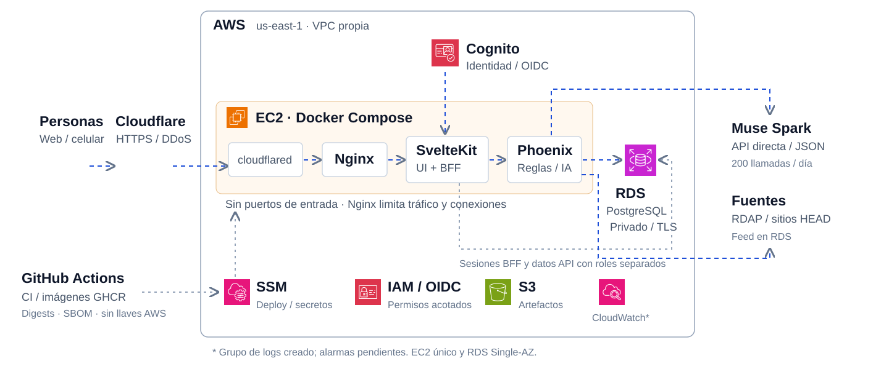

# Everyday Trust · ¿Es estafa?

Verificador de mensajes sospechosos con contexto peruano. Pegas un mensaje o enlace y recibes señales de riesgo, motivos y un siguiente paso antes de compartir dinero o datos.

Puedes empezar sin cuenta. Al registrarte tienes mayor uso, guardado voluntario e historial privado.

[Probar la web](https://verifica.deepskill.space/) · [Ver presentación](https://verifica.deepskill.space/presentacion/) · [Repositorio](https://github.com/deep-skill/everyday-trust)



## Cómo funciona

- **Reglas verificables:** detecta pedidos de claves, presión para actuar e imitaciones de marcas y dominios oficiales.
- **Alertas conocidas:** compara hosts con un snapshot versionado de Phishing.Database y muestra su cobertura; una ausencia de coincidencias no garantiza seguridad.
- **Destino del enlace:** comprueba la raíz pública mediante HEAD, con DNS/IP fijados y redirecciones revalidadas. Omite la ruta y los parámetros; los acortadores permitidos tienen resolución acotada.
- **IA con piso de reglas:** Muse Spark Contributor recibe el mensaje completo y la evidencia durante el piloto. La salida estructurada puede elevar la sospecha, pero nunca rebajar el riesgo detectado por reglas.
- **Límites por capas:** controles de entrada, cuotas atómicas en PostgreSQL y topes globales de llamadas al modelo limitan uso y consumo.

## Estado actual

Desplegado en AWS: SvelteKit y BFF Node, API Elixir/Phoenix, RDS PostgreSQL privado y Cognito. Cuenta con consulta anónima, ayuda acotada, acceso, historial privado, borrado, métricas agregadas y valoraciones con comentario privado. El texto original no se persiste en el historial ni en logs. EC2 no expone puertos entrantes; el acceso público usa Cloudflare Tunnel.

La [implementación](docs/architecture/implementation.md) detalla capacidades y evidencia. Las [decisiones técnicas](docs/architecture/stack-decision.md) explican el stack y las alternativas descartadas.

## Mapa del repositorio

```text
api/            API Phoenix; pruebas en api/test/
src/            Web SvelteKit y BFF
tests/          Pruebas web en sealed.test.mjs
tests/e2e/      Pruebas de navegador con identidad simulada
docs/           Negocio, UX, arquitectura y presentación
```

## Desarrollo local

Requisitos: Node 24 y Docker Compose. Elixir y PostgreSQL se ejecutan en contenedores.

```bash
npm ci
cp .env.example .env
docker compose -f compose.dev.yml up -d --build
docker compose -f compose.dev.yml exec api-dev mix deps.get --check-locked
docker compose -f compose.dev.yml exec api-dev mix ecto.setup
node --env-file=.env scripts/migrate-web.mjs
```

En terminales separadas:

```bash
docker compose -f compose.dev.yml exec api-dev mix phx.server
npm run dev
```

La consulta anónima funciona sin Cognito ni IA. Compose desactiva la red de la API con `NETWORK_CHECKS=false`; ejecutar la API fuera de Compose activa la red por defecto, salvo en pruebas. Las variables se documentan en [.env.example](.env.example) y [api/.env.example](api/.env.example).

## Pruebas

La suite combina pruebas Phoenix y pruebas web de cifrado de sesión; el total vigente se publica en CI. Los casos del motor anterior se retiraron; las reglas de producción se prueban en Phoenix. La evaluación sintética de 24 casos es parte de esa suite, no una medida de precisión real ni de calidad del modelo.

```bash
npm run check && npm test

docker compose -f compose.dev.yml exec -e MIX_ENV=test api-dev mix deps.get --check-locked
docker compose -f compose.dev.yml exec -e MIX_ENV=test api-dev mix format --check-formatted
docker compose -f compose.dev.yml exec -e MIX_ENV=test api-dev mix compile --warnings-as-errors
docker compose -f compose.dev.yml exec -e MIX_ENV=test api-dev mix ecto.create
docker compose -f compose.dev.yml exec -e MIX_ENV=test api-dev mix ecto.migrate
docker compose -f compose.dev.yml exec -e MIX_ENV=test api-dev mix test
```

[CI](https://github.com/deep-skill/everyday-trust/actions/workflows/ci.yml) ejecuta tipos, build, pruebas web, formato, compilación y pruebas Phoenix. Las [pruebas de navegador](tests/e2e/run.py) usan una base separada e identidad simulada; su ejecución completa no forma parte de cada CI. [Método e informe de evaluación](docs/architecture/evaluation.md).

## Límites conocidos

La revisión orienta; no autentica al remitente ni garantiza seguridad. El feed disponible es histórico. No se analiza HTML, no se ejecuta JavaScript y no se inspecciona la ruta concreta de un enlace arbitrario. Las comprobaciones externas y la IA pueden fallar; la cobertura lo indica.

El piloto envía contexto completo a Contributor; antes de difusión general se revisará el proveedor y su tratamiento de datos. Las cuotas limitan llamadas, pero no hay un presupuesto monetario duro verificado en el proveedor. La infraestructura inicial usa un EC2 y RDS Single-AZ; restauración de backups y alta/recuperación con correo real siguen pendientes de prueba. Capturas, QR, extensión y apps son roadmap.

[Seguridad y reporte de vulnerabilidades](SECURITY.md) · [Controles y límites](docs/architecture/security-review.md) · [Documentación de producto, UX y arquitectura](docs/README.md)

Proyecto de Deep Skill para Hack the Andes 2026, track Seguridad.

Las integraciones opcionales del piloto y sus límites se describen en [integraciones del piloto](docs/architecture/pilot-integrations.md). Sus cinco flags están apagados por defecto y requieren validación antes de activarse.
