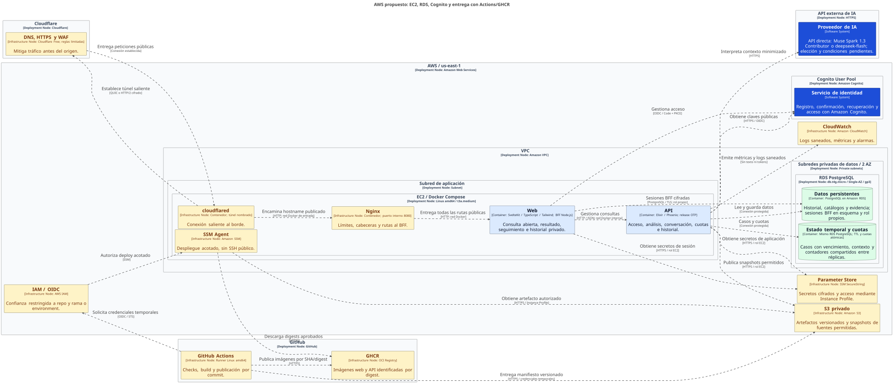

# Propuesta AWS, Docker y entrega continua

Estado: diseño del primer despliegue, 17-oct-2026. Stack y RDS confirmados por JP; servicios de ejecución y automatización propuestos, aún sin aprovisionar. La operación completa se registra en `../devops-agents/docs/hack-the-andes-seguridad.md`.

Fuente reproducible: [workspace.dsl](workspace.dsl). Los nombres de nodos representan responsabilidades, sin afirmar ids, disponibilidad ni recursos existentes. La base durable y el estado temporal son dos responsabilidades C4 dentro de un mismo PostgreSQL físico.

## Recorrido de una consulta

`Navegador → Cloudflare → Tunnel → Nginx → SvelteKit/BFF → Phoenix → RDS`

Cognito gestiona registro y acceso. Phoenix consulta fuentes permitidas y la API de IA directamente. El navegador sólo habla con la web de su mismo origen y con la pantalla de acceso de Cognito; no necesita llegar directamente a Phoenix ni a RDS.

| Pieza | Configuración propuesta | Propósito |
|---|---|---|
| Cloudflare | DNS, HTTPS, protección DDoS y WAF disponible en el plan | Entrada pública y mitigación de abuso |
| cloudflared | Contenedor con túnel nombrado hacia `nginx:8080` | Conexión saliente al borde, sin puertos web abiertos en EC2 |
| Nginx | Contenedor sin puertos publicados al host | Un punto de entrada con límites de cuerpo, tiempos de espera y cabeceras |
| SvelteKit | Imagen multi-stage con adapter-node | UI y BFF; sesión opaca, renovación y protección CSRF |
| Phoenix | Release multi-stage Elixir/OTP, API interna | Señales, política de riesgo, conversación, cuotas e historial |
| EC2 | Linux x86_64, T3a según convención de Deep Skill | Ejecutar Compose; tamaño propuesto `t3a.medium`, 2 vCPU/4 GiB |
| RDS | PostgreSQL soportado, `db.t4g.micro`, Single-AZ y 20 GiB gp3 iniciales | Estado compartido y backups gestionados, separado del host de aplicaciones |
| Cognito | User Pool y cliente web para BFF | Identidad, confirmación y recuperación |
| SSM | Parameter Store y administración del servidor | Secretos por referencia y despliegue sin SSH público |
| CloudWatch | Logs saneados, retención acotada y alarmas | Errores, latencia, disco, memoria, conexiones y fallos de despliegue |
| S3 | Bucket privado con cifrado y ciclo de vida | Artefactos de despliegue y snapshots permitidos de fuentes, sin mensajes originales |
| GitHub Actions y GHCR | Checks, build Linux amd64 e imágenes por digest | Entrega reproducible y rollback de aplicación |

El RDS ARM64 no exige que Phoenix use ARM64: se comunican por el protocolo PostgreSQL. Las imágenes de aplicación se construyen para la arquitectura del EC2. No se compila Elixir mediante emulación de Mac ARM en producción.

## Red y límites de confianza

La VPC tiene una subred de aplicación con ruta de salida a Internet y subredes privadas de datos en al menos dos zonas para el DB subnet group. La instancia RDS inicial es Single-AZ; el grupo de subredes no la convierte en Multi-AZ.

El EC2 usa una IPv4 pública dinámica sólo para salida, sin reglas de entrada al security group. Cloudflared establece la conexión hacia Cloudflare. La aplicación sale por HTTPS hacia Cognito, IA, fuentes permitidas, SSM y GHCR, y permite la salida requerida por Tunnel. SSM Agent debe estar operativo y disponer del rol y conectividad necesarios antes de depender de él para desplegar. El cambio de IP tras detener/iniciar no exige cambiar DNS del túnel.

RDS tiene `PubliclyAccessible=false`, cifrado en reposo y security group que acepta 5432 exclusivamente desde el security group del EC2. La conexión verifica TLS, CA de RDS y hostname; no se adopta `verify_none`. Referencias: [RDS en una VPC](https://docs.aws.amazon.com/AmazonRDS/latest/UserGuide/USER_VPC.WorkingWithRDSInstanceinaVPC.html) y [TLS en RDS](https://docs.aws.amazon.com/AmazonRDS/latest/UserGuide/UsingWithRDS.SSL.html).

Compose separa las redes de entrada y aplicación: cloudflared llega a Nginx, Nginx a la web y el BFF a Phoenix. No publica puertos de web, API ni PostgreSQL en el host. Nginx encamina las rutas públicas al BFF, incluidas `/api/*`; no las desvía directamente a Phoenix y evita eludir la sesión web.

El BFF accede a su esquema de sesiones con un rol propio. Phoenix usa otro rol limitado a datos de aplicación; una credencial de migraciones separada modifica el esquema. El usuario administrador de RDS no es la credencial de ejecución. El host compartido sigue siendo un límite de confianza común, aunque haya separación por contenedores.

## Nginx y protección de la consulta

Nginx limita tamaño de cuerpo y conexiones, aplica timeouts compatibles con la entrega inicial y reenvía cabeceras de forma controlada. Los límites de negocio y cuotas permanecen en Phoenix y PostgreSQL. La identidad y la titularidad se validan aunque la red sea interna. Referencia del límite de cuerpo: [Nginx](https://nginx.org/en/docs/http/ngx_http_core_module.html#client_max_body_size).

Los límites se fijarán sobre el contrato de entrada, actualmente hasta 5.000 caracteres, admitiendo codificación JSON/UTF-8. No se infiere el límite de bytes a partir del número de caracteres. La IP reenviada sólo se acepta desde el camino conocido de Cloudflare; el cliente no puede elegir la clave de su cuota mediante una cabecera.

Resultados, mensajes, historial y callbacks de autenticación usan `Cache-Control: no-store`; sólo los recursos estáticos públicos tienen caché. Se excluyen cuerpos, cookies, tokens y enlaces completos de logs y trazas. Cloudflare procesa tráfico antes de la minimización de Phoenix y debe figurar en la información de tratamiento de datos.

Cloudflare Tunnel permite conexiones salientes sin puertos de entrada y funciona en todos los planes. WAF y rate limiting dependen del plan: Free incluye el conjunto gratuito de reglas gestionadas y una regla de rate limiting. No se promete el WAF completo ni protección de IA por tener una API key. Los mensajes de fraude pueden contener texto que active reglas; comprobar casos sintéticos antes de ajustar excepciones específicas. Fuentes: [Tunnel](https://developers.cloudflare.com/tunnel/) y [disponibilidad WAF](https://developers.cloudflare.com/waf/).

## GitHub Actions, GHCR y despliegue

1. Pull requests ejecutan tipos, regresiones y pruebas relevantes de API con PostgreSQL efímero. No reciben credenciales de producción ni publican imágenes.
2. Un commit autorizado para entrega construye imágenes multi-stage nativas `linux/amd64`. Publica web y API en GHCR con el SHA y registra sus digests; el despliegue no consume una etiqueta mutable `latest`. Nginx y cloudflared usan versiones/digests fijados.
3. El job de publicación usa `GITHUB_TOKEN` y permisos de paquetes acotados. Si las imágenes se hacen públicas, comprobar que no contengan secretos ni contexto ignorado; un repo público no vuelve públicos sus paquetes automáticamente. Si son privadas, usar una credencial de sólo lectura en el servidor.
4. El job de deploy obtiene credenciales temporales de AWS con OIDC, limitado al repo y rama o environment acordados. Verificar el formato real del claim `sub`, incluidos ids inmutables cuando aplique; no copiar una política amplia con comodines. Los actions se fijan a un SHA revisado.
5. El manifiesto y configuración versionados se entregan a un prefijo privado de S3. SSM ejecuta un documento de despliegue acotado sobre el EC2 del proyecto: verifica artefacto/digests, obtiene secretos en el servidor, descarga imágenes y corre migraciones una sola vez.
6. Sólo tras migraciones correctas se actualizan servicios y se comprueban salud, consulta anónima y acceso. La concurrencia de deploy se serializa. Un fallo conserva diagnóstico saneado y permite volver al digest anterior si el esquema sigue compatible.

Las migraciones siguen cambios compatibles en etapas; restaurar un backup no es el rollback rutinario de una imagen. Un reemplazo Compose de una réplica puede interrumpir conexiones; no se promete cero downtime. Detalles de permisos, comandos y evidencia pertenecen al runbook operativo. Referencias: [GHCR](https://docs.github.com/en/packages/working-with-a-github-packages-registry/working-with-the-container-registry), [OIDC con AWS](https://docs.github.com/en/actions/how-tos/secure-your-work/security-harden-deployments/oidc-in-aws) y [SSM Run Command](https://docs.aws.amazon.com/systems-manager/latest/userguide/run-command.html).

## Secretos, backups y evolución

El EC2 obtiene permisos mediante Instance Profile; no se copian access keys AWS a `.env`. Los secretos de aplicación se guardan como parámetros cifrados o un almacén gestionado equivalente, por referencia, y se materializan con permisos mínimos. No entran en imágenes, user data, argumentos de build, comandos visibles ni stdout de Actions/SSM. El token general de administración Cloudflare no se instala en el contenedor del túnel; cloudflared recibe sólo su credencial de ejecución.

Se proponen backups automáticos RDS durante siete días, protección contra borrado y snapshot antes de una migración de riesgo. El objetivo de recuperación y su costo se validan con una restauración aislada: conectar con TLS, comprobar datos y permisos, invalidar sesiones/contexto temporal y conciliar borrados posteriores antes de volver a publicar. No se afirma un RTO/RPO sin probarlo. La política de datos debe explicar la expiración de copias; restaurar no habilita reponer silenciosamente casos eliminados.

El primer despliegue tiene un EC2 y RDS Single-AZ. Para mayor disponibilidad, separar réplicas de aplicación y pasar RDS a Multi-AZ, con pools y cuotas compartidos ya comprobados. ECS Fargate queda como evolución posible; el diseño modular no exige Kubernetes, Redis, RDS Proxy ni un ALB en el primer corte.

## Presupuesto y dominio

Cotizar en `us-east-1`, sin asumir que un crédito histórico cubre el gasto actual. EC2 T3a sigue la preferencia operativa de Deep Skill. La base propuesta incluye cómputo, almacenamiento y una IPv4; IA, transferencia, logs, copias adicionales, identidad y dominio se calculan aparte. Los importes y la evidencia de consulta a AWS Pricing están en el documento de `devops-agents`.

Para la demo se propone `verifica.deepskill.space`, pendiente de crear el registro. El dominio propio se elige con el nombre: revisar disponibilidad en el registrador, registro, renovación, titular y presupuesto antes de comprar. Consultar DNS o RDAP no asegura que se pueda registrar. Como referencia, [Punto.pe](https://punto.pe/tarifas.php) publica S/110 por un año de `.pe` o `.com.pe`, con impuestos; no es una cotización ni prueba de disponibilidad de un nombre concreto.

## Comprobaciones antes de anunciarlo en vivo

- Validar Compose y las imágenes con versiones fijadas; secretos ausentes en capas y logs.
- Probar entrada HTTPS, sesión, límites, fallos externos y B01 a B08 en ventana privada.
- Comprobar que ni la IP del EC2 ni RDS ofrecen acceso público a la aplicación o la BD.
- Probar deploy repetido, migraciones, rollback compatible y restauración RDS aislada.
- Registrar ids reales, permisos, costos y resultados en `devops-agents`, y actualizar ambos inventarios.

Estos controles siguen pendientes. Los diagramas y el runbook no cuentan como evidencia de un despliegue terminado.
