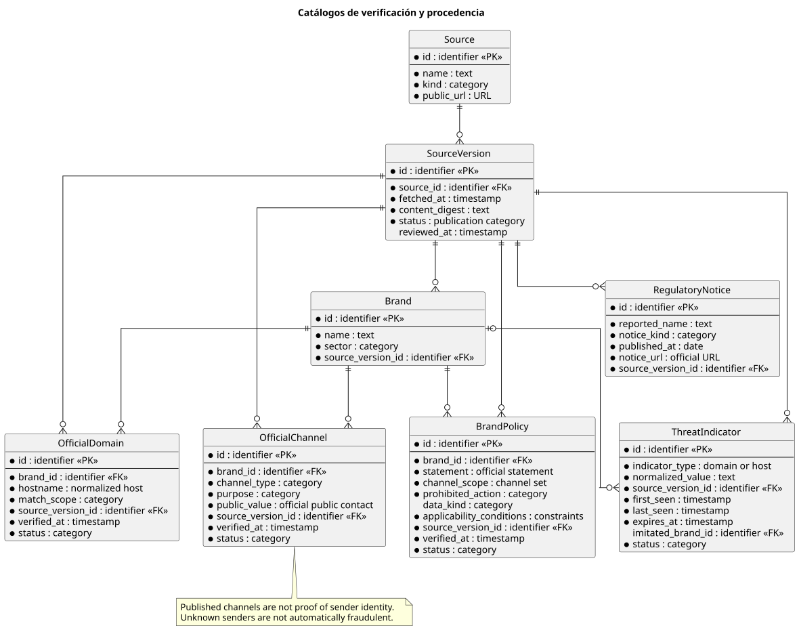
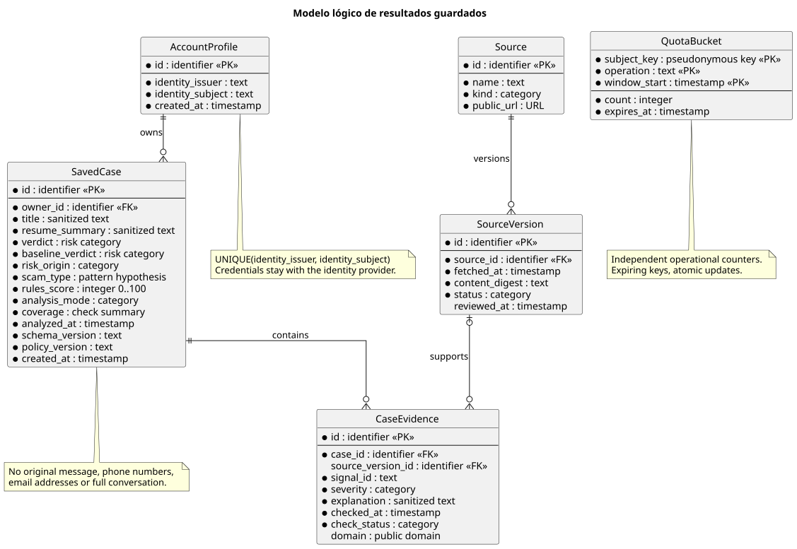

# Modelo lógico de datos y conservación

Estado: modelo lógico sobre PostgreSQL confirmado. JP eligió RDS PostgreSQL para producción; Las migraciones locales de casos, cuentas, cuotas, fuentes y sesiones están implementadas; permisos de producción y recuperación en RDS siguen pendientes. Ver [implementación](implementation.md).

El modelo conserva resultados que la persona decide guardar y la procedencia de sus evidencias. Las contraseñas y la recuperación pertenecen a Cognito; la aplicación guarda su identificador estable, no una copia de la contraseña.

## Entidades persistentes

| Entidad | Datos esenciales | Relación e invariantes |
|---|---|---|
| AccountProfile | id, identity_issuer, identity_subject, created_at | Identidad externa única por issuer y subject; no usar email como clave de titularidad |
| SavedCase | id, owner_id, title, resume_summary, verdict, baseline_verdict, risk_origin, scam_type, rules_score, analysis_mode, coverage, analyzed_at, schema_version, policy_version, created_at | Instantánea finalizada, incluso con cobertura parcial; pertenece a una cuenta y todo acceso comprueba owner_id |
| CaseEvidence | id, case_id, signal_id, severity, explanation, source_version_id opcional, checked_at, check_status, domain opcional | Pertenece a un caso; sólo contiene campos saneados y una procedencia válida |
| Source | id, name, kind, public_url | Directorio de fuentes, incluido el registro curado de dominios oficiales |
| SourceVersion | id, source_id, fetched_at, content_digest, status, reviewed_at opcional | Permite explicar con qué datos se obtuvo una señal; publicación controlada y reversible |
| QuotaBucket | subject_key, operation, window_start, count, expires_at | Contador actualizado atómicamente; claves de visitante y red seudonimizadas |

`identity_issuer` y `identity_subject` se obtienen de una sesión o token validado en el servidor. El cliente nunca puede elegir `owner_id`. Un email mutable no reasigna casos entre cuentas.

`verdict` expresa alto riesgo, sospechoso, sin señales detectadas o indeterminado. `rules_score` es un puntaje interno de reglas y nunca se presenta como probabilidad. `check_status` diferencia coincidencia, sin coincidencia, no disponible y no aplicable. `coverage` resume qué se pudo comprobar; `analysis_mode` distingue reglas de reglas complementadas por IA y `analyzed_at` fecha la evaluación, separada de su guardado. `schema_version` permite leer resultados guardados tras una actualización.

Las comprobaciones temporales también admiten `pending`; una instantánea guardada ya no contiene pendientes. Una evaluación finalizada puede ser indeterminada por evidencia insuficiente.

`baseline_verdict` conserva la evaluación por reglas; `risk_origin` distingue reglas, interpretación o combinación. `scam_type` es una hipótesis del catálogo de patrones, no una etiqueta de verdad. Una elevación sólo por IA llega como máximo a sospechoso y queda identificada en el resumen. No crea una comprobación externa ficticia en `CaseEvidence`.

Las explicaciones y el resumen persistente se producen con campos permitidos, no copiando texto libre del mensaje. Se eliminan números, correos, rutas y consultas de enlaces. Los dominios públicos pueden conservarse cuando son necesarios para explicar el hallazgo; no se conservan subdominios que identifiquen a una persona. Las señales históricas mantienen su fecha y no se presentan como una comprobación vigente.

## Catálogos de verificación

Estas entidades hacen explícitos los datos del producto; no representan tablas ya creadas. Su [ingesta](source-ingestion.md) valida procedencia, normaliza y activa versiones fuera de la consulta del usuario.

| Entidad | Datos esenciales | Invariantes |
|---|---|---|
| Brand | id, name, sector, source_version_id | Marca documentada; el nombre por sí solo no prueba relación con un mensaje |
| OfficialDomain | id, brand_id, hostname, match_scope, source_version_id, verified_at, status | Host normalizado; alcance explícito `exact_host` o `registrable_domain`; activar sólo con verificación oficial |
| OfficialChannel | id, brand_id, channel_type, purpose, public_value, source_version_id, verified_at, status | Separar remitentes publicados de canales de ayuda; coincidencia no autentica al emisor |
| BrandPolicy | id, brand_id, statement, channel_scope, prohibited_action, data_kind, applicability_conditions, source_version_id, verified_at, status | Política oficial acotada a canales y condiciones; activar sólo tras verificar fuente y vigencia |
| ThreatIndicator | id, indicator_type, normalized_value, source_version_id, first_seen, last_seen, expires_at, imitated_brand_id opcional, status | Dominio o host reportado, con fuente, fecha y caducidad; nunca un teléfono acusado por el usuario |
| RegulatoryNotice | id, reported_name, notice_kind, published_at, notice_url, source_version_id | Aviso fechado; similitud de nombre no prueba identidad ni fraude |

`SourceVersion.status` diferencia `staged`, `active`, `superseded` y `rejected`. Una actualización fallida no activa una versión vacía. Los registros curados de dominios y canales requieren revisión antes de quedar activos; el historial mantiene la versión que sustentó su evidencia.

Los teléfonos oficiales publicados pueden existir en `OfficialChannel`; la prohibición de conservar números recibidos en la consulta se aplica al contexto enviado, historial y logs. El propósito distingue ayuda/verificación de comunicación saliente, y evita usar un número de SMS como contacto de soporte. Un canal fuera del catálogo queda desconocido, sin penalización automática por ausencia.

El catálogo de acciones puede comenzar como configuración versionada de la política: ids, condiciones, texto revisado y referencias a canales activos. No se presupone otra tabla o servicio. Los resultados históricos muestran su fecha; cualquier recomendación de contacto vigente vuelve a resolverse contra el catálogo curado actual.

`BrandPolicy` permite citar una contradicción verificable: una marca publica que no solicita un tipo de dato por cierto canal y el mensaje que dice representarla lo solicita. Sólo se aplica si coinciden marca, canal, acción y condiciones; un canal desconocido no satisface una restricción específica de SMS. Negaciones y citas educativas no se interpretan automáticamente como pedidos. La política curada y la detección del pedido son comprobaciones distintas; una clasificación libre del modelo no se convierte por sí sola en señal fuerte.

Fuente editable: [source-catalog.puml](../diagrams/source-catalog.puml).

## Sesiones del BFF

`WebSession` es almacenamiento operativo temporal, separado del historial: hash del identificador opaco, issuer y subject validados, tokens Cognito cifrados, versión de clave, created_at, expires_at y revocación. El navegador sólo recibe una cookie `Secure`, `HttpOnly` y `SameSite` apropiado al flujo; no recibe refresh tokens. El BFF usa un esquema y rol PostgreSQL exclusivos, sin permisos sobre casos e historial. La API no lee los tokens de sesión del BFF.

La clave de cifrado se obtiene fuera de PostgreSQL mediante el rol del servidor. Vencimiento y revocación se comprueban al leer, con limpieza posterior; salir invalida la sesión y la renovación se coordina para evitar carreras. Los secretos de sesión no se incluyen en el historial ni en métricas. La restauración invalida sesiones y casos temporales antes de publicar el servicio. Esta responsabilidad es parte del diseño de sesión, aún sin migración implementada; el ER siguiente se concentra en resultados guardados.

## Datos temporales del caso

El original se procesa durante la entrada para extraer señales y después se descarta. El estado temporal contiene contexto y turnos minimizados, evidencia permitida, resultado, revisión de la evaluación, comprobaciones pendientes y plazo de finalización. No guarda el cuerpo original para reconstruirlo después. Los insumos necesarios para completar comprobaciones se limitan a campos permitidos y a la misma duración; no incluyen secretos ni rutas personalizadas que no sean imprescindibles.

La minimización ocurre antes de persistir contexto, encolar trabajo o llamar al modelo, y se aplica también a los seguimientos. No ofrece anonimización perfecta. Su política debe preservar los indicadores técnicos sin reenviar información personal innecesaria; si no puede preparar una entrada permitida, se mantiene el análisis por señales sin esa llamada externa. Las condiciones del proveedor sobre conservación y entrenamiento son un requisito previo a su integración.

Ese estado tiene vencimiento y control de acceso. Para varias réplicas requiere un almacén compartido; la memoria de una instancia sola no ofrece continuidad confiable. Las categorías opcionales de interacción son clic, datos compartidos y pago; se permite más de una, sin importes, credenciales ni datos del destinatario. No se conservan en el historial por defecto.

Propuesta de conservación para validar: caso temporal durante una hora de inactividad, con un máximo de cuatro horas desde su creación; casos guardados hasta su eliminación o hasta la política de inactividad acordada; contadores hasta finalizar su ventana y un margen de limpieza. La duración definitiva se documentará antes de implementar.

Un visitante recibe una sesión temporal mediante cookie protegida. Un identificador de caso aleatorio no sustituye la comprobación de acceso. Tras autenticarse, la persona confirma el guardado del caso temporal que ya le pertenecía; no se admiten transferencias por un id recibido de otro usuario.

## Métricas y borrado

La primera versión registra agregados de análisis y errores por periodo, categoría y versión de política, sin texto, enlaces completos ni números. El retorno se medirá con identificadores seudónimos de duración acotada y se describirá como retorno de navegadores o cuentas.

Las revisiones y lecturas de un caso no incrementan análisis completados: se cuenta una sola transición a evaluación final por caso, incluso tras reintentos.

El feedback opcional admite sólo «me ayudó» o «no me ayudó», sin texto libre. Se agrega por versión de política y modo de análisis, sin convertirlo en una etiqueta de fraude ni conservar una relación durable con la persona. El estado temporal permite evitar votos repetidos por caso; los reintentos no aumentan los contadores.

Eliminar un caso borra sus evidencias de forma atómica. Eliminar la cuenta requiere autenticación reciente, elimina sus casos y su perfil y coordina la baja de la identidad externa. La política de backups debe especificar su ventana de expiración y el tratamiento de solicitudes de borrado.

## Límites y consistencia

- Guardar usa una clave de idempotencia para evitar duplicados tras un reintento.
- El listado pagina resultados con un cursor estable; no descarga todo el historial.
- Se indexa la combinación de propietario, fecha e id para listar casos.
- Las fuentes oficiales se incorporan sólo tras una verificación explícita y con versión.
- No hay tablas locales de contraseñas ni catálogo público de supuestos estafadores.

Fuente editable: [data-model.puml](../diagrams/data-model.puml).

## Modelo implementado adicional

`temporary_cases` incorpora `kind` (`query` o `demo`), `analysis_pending` y `analysis_deadline`. El resultado tiene revisión monotónica y estado de finalización. `daily_metrics(day, kind, metric, count)` usa clave compuesta y aumentos atómicos; no contiene texto, identidad ni IP. Las cuotas temporales permiten contar consultas adicionales y expiran a las 48 horas.
