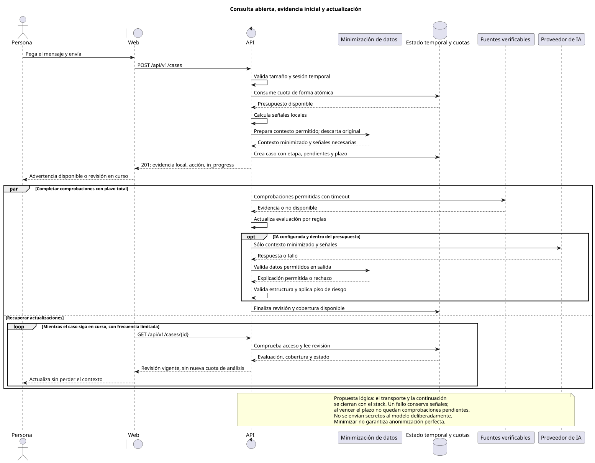
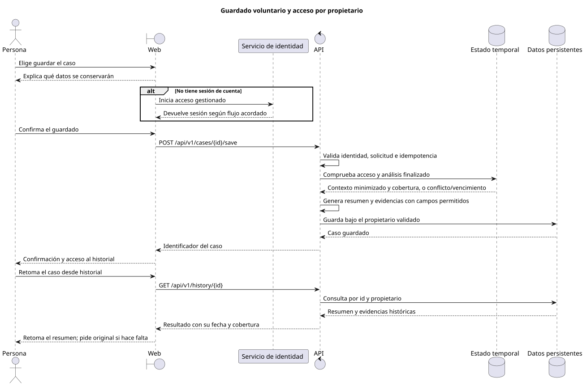

# Arquitectura lógica del servicio

Estado: diseño funcional para implementar. JP confirmó SvelteKit, Elixir/Phoenix, PostgreSQL, Cognito y BFF el 17-oct-2026. JP eligió RDS para PostgreSQL. La propuesta de despliegue usa EC2 con Docker Compose, Nginx y Cloudflare Tunnel; GitHub Actions y GHCR para entrega. Todavía no se han creado recursos.

## Responsabilidades

La web presenta el caso y sus evidencias. La API controla acceso, cuotas, análisis, seguimiento y guardado. Un proveedor de identidad resuelve las cuentas; la base de aplicación conserva resultados privados y procedencia. El proveedor de IA interpreta el caso dentro de los límites de la política de riesgo.

El backend comienza como una aplicación modular con un contrato HTTP versionado. Las responsabilidades de verificación, conversación e historial no requieren microservicios separados. La actualización de fuentes ocurre fuera de la petición del usuario, con trabajos acotados y datos versionados.

El diseño de [ingesta y catálogos](source-ingestion.md) concreta marcas, dominios, canales oficiales, indicadores de amenaza y avisos regulatorios. Distingue datos ya usados por el prototipo de copias locales y capacidades pendientes. El [contrato de interpretación](ai-interpretation.md) define entrada, salida, validación y presupuesto del modelo; el [evaluador](evaluation.md) comprobará calidad sobre un entorno de prueba, fuera de las consultas de personas.

## Vistas C4

[workspace.dsl](workspace.dsl) es la fuente del contexto, los contenedores y los componentes. Las tecnologías confirmadas y las decisiones todavía propuestas se distinguen en el modelo. Los contenedores C4 son unidades lógicas de ejecución o almacenamiento, y no equivalen necesariamente a contenedores Docker.

- Contexto: personas, servicio, identidad, fuentes e IA.
- Contenedores: web, API, datos persistentes, estado temporal compartido y evaluador local o de CI. El estado temporal comparte PostgreSQL con los datos persistentes, con vencimiento comprobado al leer y limpieza programada. Las sesiones del BFF usan un esquema y rol distintos en ese mismo motor.
- Componentes de API: acceso y cuotas, casos, señales, minimización de datos, política de riesgo, interpretación, historial e ingesta de fuentes.

Vistas generadas: [contexto](../diagrams/rendered/structurizr-Context.svg), [contenedores](../diagrams/rendered/structurizr-Containers.svg) y [componentes](../diagrams/rendered/structurizr-ApiComponents.svg).

La [propuesta física AWS](aws-deployment.md) y la [vista C4 de despliegue](../diagrams/rendered/structurizr-AwsDeployment.svg) muestran el EC2, los servicios Docker y PostgreSQL privado en RDS. La operación se documenta en `devops-agents`, sin presentar la propuesta como desplegada. C4 de código no se necesita antes de que existan clases o módulos reales.

## Flujo de análisis

1. La API valida entrada, sesión temporal y cuotas con actualización atómica.
2. Extrae señales locales usando el original sólo durante el procesamiento de entrada. No lo incorpora a logs. Minimiza datos antes de conservar contexto o preparar una petición al modelo.
3. Entrega advertencias disponibles, acciones y comprobaciones pendientes sin esperar a fuentes lentas ni a la IA. Sin evidencia suficiente, el resultado provisional es indeterminado; nunca una garantía de seguridad.
4. Completa consultas externas con plazo máximo. El corte local comprueba la raíz pública del sitio con HEAD, DNS/IP fijados y redirecciones limitadas, sin visitar la ruta concreta ni ejecutar contenido. Recalcula reglas; Contributor recibe el mensaje completo y el resultado de comprobaciones dentro del presupuesto del piloto interno autorizado por JP. Ver los límites en [implementación](implementation.md#comprobación-de-sitios-y-contributor-corte-local).
5. Valida estructura, datos permitidos y piso de riesgo. Actualiza evaluación, evidencias, cobertura y estado del caso. Un fallo marca la comprobación como no disponible y permite finalizar con cobertura parcial.

La combinación distingue procedencia: el modelo puede elevar por interpretación hasta sospechoso, aun sin una señal de reglas. Alto riesgo exige sustento adicional y ninguna interpretación rebaja el piso determinista. Esa diferencia se conserva en la respuesta y el historial.

La propuesta de contrato usa la creación del caso para entregar la evaluación inicial y consultas al mismo recurso para recuperar actualizaciones. El mecanismo de continuación y entrega se cerrará con el stack; el requisito es no retener advertencias por esperar una explicación. No se presupone un servicio adicional ni se elige entre sondeo y streaming todavía.

Los trabajos tienen un plazo total, estado compartido y finalización explícita. Al diseñar su ejecución se debe resolver qué ocurre si una réplica reinicia: recuperar el trabajo permitido o cerrar las comprobaciones pendientes como no disponibles al vencer el plazo. No se admite un caso indefinidamente «en curso».

Un fallo o timeout de la IA mantiene el resultado por reglas. La ausencia de una fuente no se traduce en una comprobación satisfactoria. Los enlaces externos se muestran como evidencia sin hacerlos el camino principal de acción.

La minimización preserva las señales necesarias para comprobar dominios y patrones; no reemplaza indiscriminadamente números o partes de URL antes de analizarlos. El modelo recibe sólo contexto permitido, con posibles DNI, tarjetas, códigos y datos de contacto omitidos o sustituidos. Su detección puede fallar: se limita el contexto, se valida también la salida y se informa al usuario. La política de conservación y entrenamiento del proveedor se valida antes de integrar la IA.

## Continuidad y guardado

Los casos temporales están asociados a una sesión protegida y vencen. Si se ejecutan varias réplicas, comparten su estado; no se exige que el usuario vuelva a la misma instancia. El backend minimiza antes del estado temporal y aplica un saneamiento más restrictivo basado en campos permitidos antes de guardar; vuelve a comprobar titularidad al listar, retomar o borrar. El historial recibe una instantánea finalizada y su cobertura, sin sobrescribir silenciosamente evidencia histórica.

La conversación retoma un caso temporal o el resumen de uno guardado. Puede recibir categorías opcionales de interacción, como clic, datos compartidos o pago, sin los valores involucrados. Todo turno atraviesa la misma minimización. Se trata todo mensaje recibido como contenido no confiable. Los resultados del modelo no conceden permisos, cambian cuotas, modifican fuentes oficiales ni ejecutan acciones en bancos.

Fuentes editables: [sequences.puml](../diagrams/sequences.puml).

## Escalabilidad y operación

La API puede tener varias réplicas si las cuotas, sesiones temporales y datos durables tienen consistencia compartida. El tamaño de los pools de conexiones y los límites de llamadas externas se calculan para la suma de réplicas. Aumentar instancias no elimina las cuotas del proveedor de IA.

Se requieren límites de entrada y salida, concurrencia acotada, caché con caducidad, cancelación al vencer el plazo y reintentos sólo para operaciones idempotentes. Los trabajos de fuentes usan exclusión para no duplicar una actualización al escalar.

Las métricas separan tiempo a primera ayuda y a evaluación final; incluyen cobertura parcial, errores de dependencia y consumo por operación. El feedback opcional mide utilidad, sin usarse como verdad de fraude ni cambiar listas automáticamente. Los logs contienen identificador de petición, versión de política y estado; excluyen texto, números, tokens, cookies y enlaces completos.

## Contrato y validación

El contrato HTTP documenta casos temporales y resultados guardados, con ejemplos sintéticos. Los tests de aceptación deben recorrer B01 a B08, aislamiento entre cuentas, vencimiento de casos, idempotencia, cuotas concurrentes, pérdida de dependencias e inyección de instrucciones en el mensaje.

Los informes de evaluación identifican corpus, snapshots, política, instrucciones y modelo; separan errores peligrosos, falsos positivos, abstención, cobertura, latencia y costo. No se mezclan ejecuciones internas con tracción. El ejecutor y su conexión a CI son trabajo pendiente, no una capacidad ya desplegada.

La migración del prototipo conservará su conjunto de regresión como criterio de paridad. El borrador Better Auth/D1 queda fuera de la arquitectura objetivo; ya está aislado en `wip/paused-cloudflare-auth` y no se integra a la nueva API.
