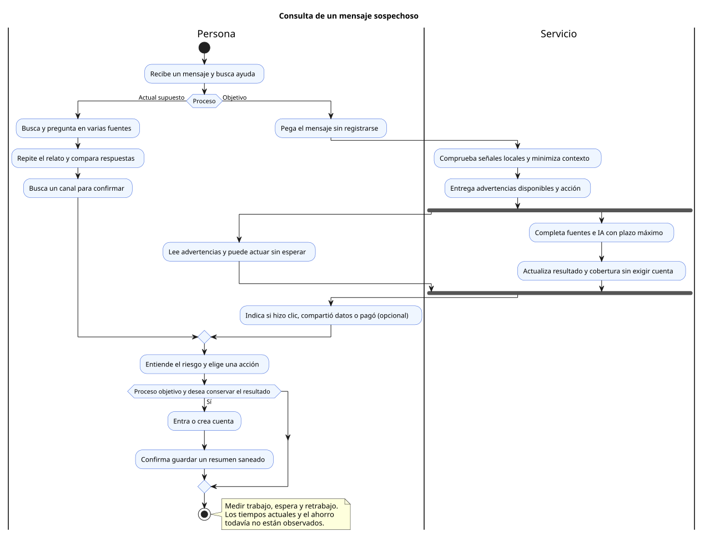

# Mapa del flujo de valor de la consulta

Estado: hipótesis de proceso para validar con usuarios. VSM significa Value Stream Mapping, o mapa del flujo de valor.

El flujo comienza cuando llega un mensaje sospechoso y termina cuando la persona entiende el riesgo y elige una acción. El mapa separa trabajo útil, esperas y retrabajo; todavía no hay tiempos observados para afirmar ahorros.

## Flujo actual supuesto

| Paso | Trabajo de la persona | Espera o retrabajo | Dato para observar |
|---|---|---|---|
| Recibir | Leer e identificar una duda | La urgencia del mensaje puede precipitar la decisión | Momento en que busca ayuda |
| Investigar | Buscar el dominio, la marca o preguntar a alguien | Saltar entre fuentes y repetir el relato | Cantidad de cambios de herramienta |
| Interpretar | Comparar respuestas y decidir qué creer | Resultados contradictorios o sin fuente | Dudas pendientes |
| Actuar | Ignorar, verificar por un canal conocido o pedir ayuda | Buscar otra vez el canal correcto | Tiempo y comprensión de la acción |
| Volver | Reconstruir el caso si continúa la duda | Evidencia dispersa o perdida | Información que vuelve a introducir |

## Flujo objetivo

| Paso | Valor entregado | Espera necesaria | Control de calidad |
|---|---|---|---|
| Pegar el mensaje | Reunir el caso en una entrada | Ninguna pantalla de registro previa | Advertir datos a omitir, permitir corrección y validar tamaño |
| Revisar señales | Advertir con evidencia local sin esperar al modelo | Fuentes lentas e IA continúan con plazo máximo | Minimizar antes de conservar o enviar; mostrar lo pendiente |
| Completar resultado | Entender riesgo y siguiente paso | Actualización de evidencia y explicación | Distinguir veredicto de cobertura; no convertir pendientes en ausencia de riesgo |
| Aclarar situación | Adaptar prevención o respuesta a clic, datos compartidos o pago | Pregunta opcional, sin pedir secretos | Mantener el piso de riesgo y el alcance |
| Guardar si desea | Conservar un resumen útil | Registro sólo si decide guardar | Confirmar qué se conserva |
| Retomar o borrar | Continuidad y control de sus datos | Carga del historial privado | Verificar titularidad en cada operación |

Fuente editable: [value-stream.puml](../diagrams/value-stream.puml).

## Medición antes y después

Se observarán tiempo de trabajo, espera y retrabajo por etapa en la misma tarea. Lead time es el tiempo total desde que la persona busca ayuda hasta que elige una acción; no se confunde con la latencia de la API.

Se miden por separado la primera ayuda visible y la evaluación final. La acción ante una advertencia sustentada no debe esperar al registro, al guardado ni a la explicación del modelo. Una actualización parcial debe declarar qué no pudo comprobarse.

La comparación debe registrar dispositivo, caso y experiencia previa, y usar ejemplos equivalentes. Las metas iniciales son hipótesis: reducir cambios de herramienta, entregar el primer resultado sin registro y evitar que la conversación obligue a repetir el mensaje. El porcentaje de mejora se calculará después de medir ambas condiciones.

## Trazabilidad al producto

La entrada abierta corresponde a B01; evidencias y comprobaciones a B02; aclaraciones a B03; guardado y retorno a B04 y B05. B06 controla sostenibilidad sin interrumpir innecesariamente una consulta, y B07 y B08 limitan los datos necesarios para medir el flujo.
